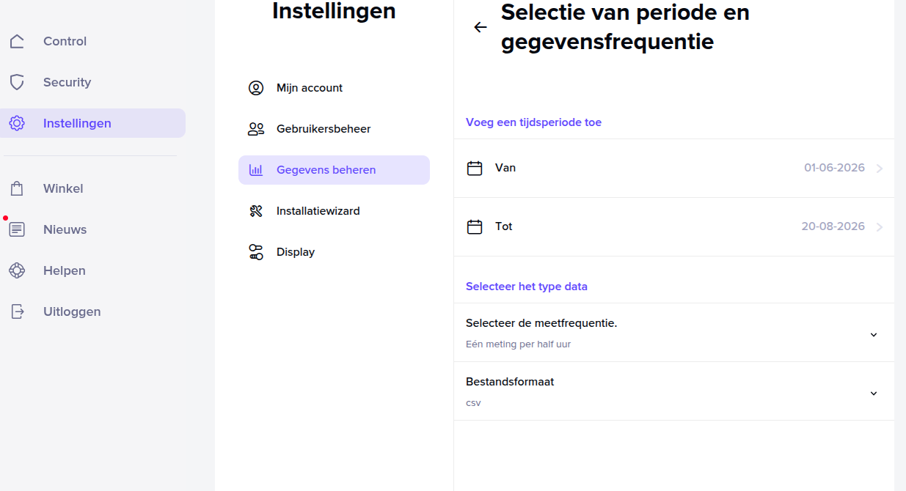

# knmiweeer
https://editor.swagger.io/
See 
- [1 building simple rust client on youtube](https://www.youtube.com/watch?v=y4UcnudFhM0)
- [building rust client](https://www.youtube.com/watch?v=brX4gzQhYs8)
- [building sdk from openapi spec](https://www.youtube.com/watch?v=uQc9_vBhxYI)

## API Clients
- [postman](https://www.postman.com/)
- [insomnia](https://insomnia.rest/)
- [hoppscotch](https://hoppscotch.io/)

## 1 building simple rust client on youtube

Credentials for youtube: https://console.cloud.google.com/apis/credentials?project=123vrienden


https://www.youtube.com/watch?v=y4UcnudFhM0  39:00

Youtub API https://developers.google.com/youtube/data/reference/rest 

Create credential through https://console.cloud.google.com/apis/credentials

See https://pinguin-01-s-team.postman.co/workspace/My-Workspace~f0ccf46d-5f2e-42f7-82a2-7ce4d9071023/http-request/1046816-5b30091e-89e5-4a06-a433-292c56bc7511?sideView=agentMode 

https://www.phind.com 

## Data

| Onderdeel       | Geladen                              |
|-----------------|--------------------------------------|
| eview (gas)     | 2023-05-14 02:00 to 2026-01-01 00:00 |
| eview (electra) | 2023-03-18 01:00 to 2026-01-01 00:00 |
| netamo          | 2025-07-14 17:15 to 2026-11-01 23:45 |
| metingen (knmi) | 2023-01-01       to 2026-11-06       |

Alle data naar dagoverzicht exporteren kan nadat alle data geladen zijn. Voor eview data moet eerst een python virtual environment gemaakt worden zie [hier](#eview)
```bash
./scripts/export_dagoverzicht.bash 
```

### Netamo
Ophalen data via: https://home.netatmo.com/settings/data-management/download/settings-download-data



De download levert een zip file op.
Rename en Verplaats de Weather.csv naar data/netamo-&lt;from&gt;-to-&lt;to&gt; where &lt;from&gt; and &lt;to&gt; are dates in format yyyy-mm-dd.

Gebruikt script [import-netamo](./scripts/import-netamo.bash) om de gegevens te importeren.

Voorbeeld:

```bash
 ./scripts/import-netamo.bash ./data/netamo-2026-01-01-to-2026-03-01.csv 
BEGIN
CREATE TABLE
COPY 2880
INSERT 0 2832
COMMIT
Klaar: 2880 rijen verwerkt uit ./data/netamo-2026-01-01-to-2026-03-01.csv (dubbele timestamps overgeslagen).
```

### EView
Ophalen data via: https://www.eview.nl/#/analysis 


De download levert een bestand meetdata.xlxs op.

Requirements 
- a python virtual envronment
- installed packages
#### Python veritual environment
```bash
python3 -m venv .venv
.venv/bin/pip install --upgrade pip
```
#### Installing packages
```bash
.venv/bin/pip install openpyxl
```

#### Execution
```bash
PYTHON_BIN="$PWD/.venv/bin/python" ./scripts/import-eview.bash ./data/meetdata-2024-01-01-to-2025-01-01.xlsx
```

## Query

netcdf = "3"          // vereist libnetcdf: `sudo apt install libnetcdf-dev`

```text
// ============================================================
// Gebruik
// ============================================================
// Eerste run (nog geen state):
//   export KNMI_API_KEY=<key>
//   cargo run -- --date 2026-10-01
//
// Vervolgruns (state bestaat, --date wordt genegeerd):
//   cargo run --                  # haalt de volgende 144 bestanden op
//   cargo run -- --max-files 1000 # grotere hap per run
//
// Nieuwe locatie? Reset de sync:
//   rm knmi_state.json temperatuur.csv
//   cargo run -- --date 2026-10-01 --lat 52.030 --lon 5.553
```

## Stations

```text
0 - 20000 - 0 - 06275
│    │      │    └── WMO station number (06275 = Deelen)
│    │      └─────── Organization-local series
│    └────────────── WMO block number (20000 = Netherlands, block 06 series)
└─────────────────── Issuing agency (0 = WMO member)
```

```bash
curl -s -H "Authorization: $KNMI_EDR_API_KEY" \
  "https://api.dataplatform.knmi.nl/edr/v1/collections/10-minute-in-situ-meteorological-observations/locations" \
  | jq '.features[] | select(.id == "0-20000-0-06275")'
```

[api usage](https://developer.dataplatform.knmi.nl/member/)

```bash
./procesjaar.bash 2023 > a.a 2>&1
```

# Gnuplot
See [link](http://www.gnuplot.info/docs_6.1/gnuplot6.html)

From the script directory
```bash
DEBUG=1 ./netamo-kanaal.bash 
```