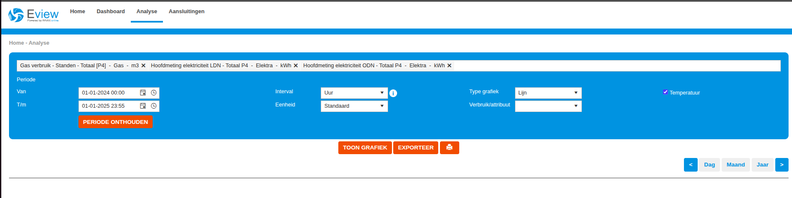

# knmiweeer
https://editor.swagger.io/
See 
- [1 building simple rust client on youtube](https://www.youtube.com/watch?v=y4UcnudFhM0)
- [building rust client](https://www.youtube.com/watch?v=brX4gzQhYs8)
- [building sdk from openapi spec](https://www.youtube.com/watch?v=uQc9_vBhxYI)

## API Clients
- [postman](https://www.postman.com/)
- [insomnia](https://insomnia.rest/)
- [hoppscotch](https://hoppscotch.io/)

## 1 building simple rust client on youtube

Credentials for youtube: https://console.cloud.google.com/apis/credentials?project=123vrienden


https://www.youtube.com/watch?v=y4UcnudFhM0  39:00

Youtub API https://developers.google.com/youtube/data/reference/rest 

Create credential through https://console.cloud.google.com/apis/credentials

See https://pinguin-01-s-team.postman.co/workspace/My-Workspace~f0ccf46d-5f2e-42f7-82a2-7ce4d9071023/http-request/1046816-5b30091e-89e5-4a06-a433-292c56bc7511?sideView=agentMode 

https://www.phind.com 

## Data

| Onderdeel       | Geladen                              |
|-----------------|--------------------------------------|
| eview (gas)     | 2023-05-14 02:00 to 2026-01-01 00:00 |
| eview (electra) | 2023-03-18 01:00 to 2026-01-01 00:00 |
| netamo          | 2025-07-14 17:15 to 2026-11-01 23:45 |
| metingen (knmi) | 2023-01-01       to 2026-11-06       |

Alle data naar dagoverzicht exporteren kan nadat alle data geladen zijn. Voor eview data moet eerst een python virtual environment gemaakt worden zie [hier](#eview)
```bash
./scripts/export_dagoverzicht.bash 
```

### Netamo
Ophalen data via: https://home.netatmo.com/settings/data-management/download/settings-download-data


De download levert een zip file op.
Rename en Verplaats de Weather.csv naar data/netamo-&lt;from&gt;-to-&lt;to&gt; where &lt;from&gt; and &lt;to&gt; are dates in format yyyy-mm-dd.

Gebruikt script [import-netamo](./scripts/import-netamo.bash) om de gegevens te importeren.

Voorbeeld:

```bash
 ./scripts/import-netamo.bash ./data/netamo-2026-01-01-to-2026-03-01.csv 
BEGIN
CREATE TABLE
COPY 2880
INSERT 0 2832
COMMIT
Klaar: 2880 rijen verwerkt uit ./data/netamo-2026-01-01-to-2026-03-01.csv (dubbele timestamps overgeslagen).
```

### EView
Ophalen data via: https://www.eview.nl/#/analysis 



De download levert een bestand meetdata.xlxs op.

Requirements 
- a python virtual envronment
- installed packages
#### Python veritual environment
```bash
python3 -m venv .venv
.venv/bin/pip install --upgrade pip
```
#### Installing packages
```bash
.venv/bin/pip install openpyxl
```

#### Execution
```bash
PYTHON_BIN="$PWD/.venv/bin/python" ./scripts/import-eview.bash ./data/meetdata-2024-01-01-to-2025-01-01.xlsx
```

## Query

netcdf = "3"          // vereist libnetcdf: `sudo apt install libnetcdf-dev`

```text
// ============================================================
// Gebruik
// ============================================================
// Eerste run (nog geen state):
//   export KNMI_API_KEY=<key>
//   cargo run -- --date 2026-10-01
//
// Vervolgruns (state bestaat, --date wordt genegeerd):
//   cargo run --                  # haalt de volgende 144 bestanden op
//   cargo run -- --max-files 1000 # grotere hap per run
//
// Nieuwe locatie? Reset de sync:
//   rm knmi_state.json temperatuur.csv
//   cargo run -- --date 2026-10-01 --lat 52.030 --lon 5.553
```

## Stations

```text
0 - 20000 - 0 - 06275
│    │      │    └── WMO station number (06275 = Deelen)
│    │      └─────── Organization-local series
│    └────────────── WMO block number (20000 = Netherlands, block 06 series)
└─────────────────── Issuing agency (0 = WMO member)
```

```bash
curl -s -H "Authorization: $KNMI_EDR_API_KEY" \
  "https://api.dataplatform.knmi.nl/edr/v1/collections/10-minute-in-situ-meteorological-observations/locations" \
  | jq '.features[] | select(.id == "0-20000-0-06275")'
```

[api usage](https://developer.dataplatform.knmi.nl/member/)

```bash
./procesjaar.bash 2023 > a.a 2>&1
```

# Gnuplot
See [link](http://www.gnuplot.info/docs_6.1/gnuplot6.html)

From the script directory
```bash
DEBUG=1 ./netamo-kanaal.bash 
```

# Correlation

How can I determine if there is a correlation between the any of the fields:

buiten_mean_temp
avg_temp_kerk_ruimte
avg_temp_kerk_inblaas
avg_temp_kerk_retour
avg_electra
avg_gas

## Pairwise Correlation Matrix Across All 6 Fields
```sql
WITH pairs AS (
    SELECT 'buiten_mean_temp' AS f1, buiten_mean_temp AS v1,
           'avg_temp_kerk_ruimte' AS f2, avg_temp_kerk_ruimte AS v2 FROM public.dagoverzicht
    UNION ALL
    SELECT 'buiten_mean_temp', buiten_mean_temp, 'avg_temp_kerk_inblaas', avg_temp_kerk_inblaas FROM public.dagoverzicht
    UNION ALL
    SELECT 'buiten_mean_temp', buiten_mean_temp, 'avg_temp_kerk_retour', avg_temp_kerk_retour FROM public.dagoverzicht
    UNION ALL
    SELECT 'buiten_mean_temp', buiten_mean_temp, 'avg_electra', avg_electra FROM public.dagoverzicht
    UNION ALL
    SELECT 'buiten_mean_temp', buiten_mean_temp, 'avg_gas', avg_gas FROM public.dagoverzicht
    UNION ALL
    SELECT 'avg_temp_kerk_ruimte', avg_temp_kerk_ruimte, 'avg_temp_kerk_inblaas', avg_temp_kerk_inblaas FROM public.dagoverzicht
    UNION ALL
    SELECT 'avg_temp_kerk_ruimte', avg_temp_kerk_ruimte, 'avg_temp_kerk_retour', avg_temp_kerk_retour FROM public.dagoverzicht
    UNION ALL
    SELECT 'avg_temp_kerk_ruimte', avg_temp_kerk_ruimte, 'avg_electra', avg_electra FROM public.dagoverzicht
    UNION ALL
    SELECT 'avg_temp_kerk_ruimte', avg_temp_kerk_ruimte, 'avg_gas', avg_gas FROM public.dagoverzicht
    UNION ALL
    SELECT 'avg_temp_kerk_inblaas', avg_temp_kerk_inblaas, 'avg_temp_kerk_retour', avg_temp_kerk_retour FROM public.dagoverzicht
    UNION ALL
    SELECT 'avg_temp_kerk_inblaas', avg_temp_kerk_inblaas, 'avg_electra', avg_electra FROM public.dagoverzicht
    UNION ALL
    SELECT 'avg_temp_kerk_inblaas', avg_temp_kerk_inblaas, 'avg_gas', avg_gas FROM public.dagoverzicht
    UNION ALL
    SELECT 'avg_temp_kerk_retour', avg_temp_kerk_retour, 'avg_electra', avg_electra FROM public.dagoverzicht
    UNION ALL
    SELECT 'avg_temp_kerk_retour', avg_temp_kerk_retour, 'avg_gas', avg_gas FROM public.dagoverzicht
    UNION ALL
    SELECT 'avg_electra', avg_electra, 'avg_gas', avg_gas FROM public.dagoverzicht
)
SELECT
    f1,
    f2,
    count(*) FILTER (WHERE v1 IS NOT NULL AND v2 IS NOT NULL) AS n_pairs,
    round(corr(v1, v2)::numeric, 4) AS pearson_r,
    round((power(corr(v1, v2), 2))::numeric, 4) AS r_squared
FROM pairs
GROUP BY f1, f2
ORDER BY abs(corr(v1, v2)) DESC NULLS LAST;

          f1           |          f2           | n_pairs | pearson_r | r_squared 
-----------------------+-----------------------+---------+-----------+-----------
 avg_temp_kerk_ruimte  | avg_temp_kerk_inblaas |     476 |    0.9280 |    0.8611
 avg_temp_kerk_ruimte  | avg_temp_kerk_retour  |     475 |    0.9146 |    0.8365
 buiten_mean_temp      | avg_temp_kerk_retour  |     444 |    0.8858 |    0.7847
 avg_temp_kerk_inblaas | avg_temp_kerk_retour  |     475 |    0.8785 |    0.7717
 buiten_mean_temp      | avg_gas               |     335 |   -0.8406 |    0.7066
 buiten_mean_temp      | avg_temp_kerk_ruimte  |     445 |    0.8147 |    0.6637
 buiten_mean_temp      | avg_temp_kerk_inblaas |     445 |    0.6685 |    0.4468
 avg_temp_kerk_retour  | avg_gas               |     171 |   -0.6485 |    0.4205
 avg_temp_kerk_ruimte  | avg_gas               |     172 |   -0.4763 |    0.2269
 avg_electra           | avg_gas               |     366 |    0.3697 |    0.1367
 buiten_mean_temp      | avg_electra           |     335 |   -0.3645 |    0.1328
 avg_temp_kerk_inblaas | avg_gas               |     172 |   -0.2960 |    0.0876
 avg_temp_kerk_inblaas | avg_electra           |     172 |    0.2567 |    0.0659
 avg_temp_kerk_ruimte  | avg_electra           |     172 |   -0.0670 |    0.0045
 avg_temp_kerk_retour  | avg_electra           |     171 |    0.0162 |    0.0003
(15 rows)
```

- n_pairs: Shows how many days actually have data for both columns (important when gas, electricity, outdoor, or church sensor coverage differs).

- pearson_r: Ranges from -1 (strong negative linear relationship) to +1 (strong positive linear relationship); 0 means no linear relationship.

- r_squared: Share of variance in one variable explained linearly by the other.

## Check Rank (Spearman) Correlation for Non-Linear Relationships

```sql
WITH ranked AS (
    SELECT
        datum,
        CASE WHEN buiten_mean_temp IS NOT NULL
             THEN rank() OVER (ORDER BY buiten_mean_temp) END AS r_buiten_temp,
        CASE WHEN avg_temp_kerk_ruimte IS NOT NULL
             THEN rank() OVER (ORDER BY avg_temp_kerk_ruimte) END AS r_kerk_ruimte,
        CASE WHEN avg_temp_kerk_inblaas IS NOT NULL
             THEN rank() OVER (ORDER BY avg_temp_kerk_inblaas) END AS r_kerk_inblaas,
        CASE WHEN avg_temp_kerk_retour IS NOT NULL
             THEN rank() OVER (ORDER BY avg_temp_kerk_retour) END AS r_kerk_retour,
        CASE WHEN avg_electra IS NOT NULL
             THEN rank() OVER (ORDER BY avg_electra) END AS r_electra,
        CASE WHEN avg_gas IS NOT NULL
             THEN rank() OVER (ORDER BY avg_gas) END AS r_gas
    FROM public.dagoverzicht
)
SELECT
    round(corr(r_buiten_temp, r_gas)::numeric, 4) AS spearman_buiten_temp_gas,
    round(corr(r_buiten_temp, r_kerk_ruimte)::numeric, 4) AS spearman_buiten_temp_ruimte,
    round(corr(r_kerk_inblaas, r_kerk_retour)::numeric, 4) AS spearman_inblaas_retour,
    round(corr(r_electra, r_gas)::numeric, 4) AS spearman_electra_gas
FROM ranked;
 spearman_buiten_temp_gas | spearman_buiten_temp_ruimte | spearman_inblaas_retour | spearman_electra_gas 
--------------------------+-----------------------------+-------------------------+----------------------
                  -0.8795 |                      0.8268 |                  0.8901 |               0.5297
(1 row)
```

## Watch Out for Seasonal / Confounding Effects & Sample Size

```sql
SELECT
    count(*) AS n,
    round(corr(buiten_mean_temp, avg_gas)::numeric, 4) AS r,
    round((
        corr(buiten_mean_temp, avg_gas) *
        sqrt((count(*) - 2)::double precision / GREATEST(1.0 - power(corr(buiten_mean_temp, avg_gas), 2), 1e-12))
    )::numeric, 2) AS t_stat
FROM public.dagoverzicht
WHERE buiten_mean_temp IS NOT NULL
  AND avg_gas IS NOT NULL
HAVING count(*) > 2;
  n  |    r    | t_stat 
-----+---------+--------
 335 | -0.8406 | -28.32
(1 row)
```
- Seasonal confounding: Both buiten_mean_temp and avg_gas follow strong seasonal cycles. Two variables can look correlated across a full year simply because both vary with the seasons. Comparing correlations within the same month/season (e.g., GROUP BY maand) helps separate seasonal drift from day-to-day relationships.
- Statistical significance (t-statistic): A high correlation on only a handful of overlapping days (n_pairs) is much less reliable than a moderate correlation on hundreds of days. For $n$ paired rows and correlation $r$, the approximate t-statistic is:

$$t = r \sqrt{\frac{n - 2}{1 - r^2}}$$


```sql
SELECT
    jaar,maand,
    count(*) AS n,
    round(corr(buiten_mean_temp, avg_gas)::numeric, 4) AS r,
    round((
        corr(buiten_mean_temp, avg_gas) *
        sqrt((count(*) - 2)::double precision / GREATEST(1.0 - power(corr(buiten_mean_temp, avg_gas), 2), 1e-12))
    )::numeric, 2) AS t_stat
FROM public.dagoverzicht
WHERE buiten_mean_temp IS NOT NULL
  AND avg_gas IS NOT NULL
GROUP BY jaar, maand
HAVING count(*) > 2
ORDER BY maand;
 jaar | maand | n  |    r    | t_stat 
------+-------+----+---------+--------
 2025 |     1 | 31 | -0.8532 |  -8.81
 2025 |     2 | 28 | -0.8621 |  -8.67
 2025 |     3 | 31 | -0.6273 |  -4.34
 2025 |     4 | 30 | -0.3612 |  -2.05
 2025 |     5 | 31 | -0.2213 |  -1.22
 2025 |     6 | 30 | -0.2904 |  -1.61
 2025 |     7 | 31 | -0.2546 |  -1.42
 2025 |     8 | 31 |  0.0768 |   0.41
 2025 |     9 | 30 | -0.3783 |  -2.16
 2025 |    10 | 31 | -0.8373 |  -8.25
 2025 |    11 | 30 | -0.8399 |  -8.19
(11 rows)

```